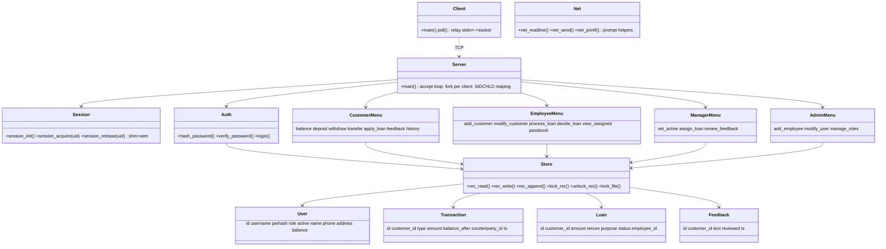

# V1 Implementation Plan — Banking Management System

Source of truth: `Mini Project - Banking Management System.docx` (IIIT Bangalore, CS-513 System Software – Mini Project).

## 1. Project objective

Simulate the core functions of a bank: customer account management, transactions, loan processing and administrative oversight. The system must have secure logins, role-based access for four roles, data consistency, and correct handling of race conditions through file management, locking and process synchronization. A socket server holds the data and serves several clients at once.

## 2. Requirements extracted from the document

### 2.1 Functional requirements (explicit)

| ID | Role | Requirement |
|----|------|-------------|
| C1 | Customer | Login (one session per user) |
| C2 | Customer | View account balance |
| C3 | Customer | Deposit money |
| C4 | Customer | Withdraw money |
| C5 | Customer | Transfer funds |
| C6 | Customer | Apply for a loan |
| C7 | Customer | Change password |
| C8 | Customer | Add feedback |
| C9 | Customer | View transaction history |
| C10 | Customer | Logout |
| C11 | Customer | Exit |
| E1 | Employee | Login (one session per user) |
| E2 | Employee | Add new customer |
| E3 | Employee | Modify customer details |
| E4 | Employee | Process loan applications |
| E5 | Employee | Approve/reject loans |
| E6 | Employee | View assigned loan applications |
| E7 | Employee | View customer transactions (passbook) |
| E8–E10 | Employee | Change password, logout, exit |
| M1 | Manager | Login (one session per user) |
| M2 | Manager | Activate/deactivate customer accounts |
| M3 | Manager | Assign loan applications to employees |
| M4 | Manager | Review customer feedback |
| M5–M7 | Manager | Change password, logout, exit |
| A1 | Admin | Login (one session per user) |
| A2 | Admin | Add new bank employee |
| A3 | Admin | Modify customer/employee details |
| A4 | Admin | Manage user roles |
| A5–A7 | Admin | Change password, logout, exit |

### 2.2 Technical and non-functional requirements (explicit)

| ID | Requirement |
|----|-------------|
| T1 | Socket programming: the server maintains the database and serves multiple clients concurrently; clients connect and access their own account details. |
| T2 | Use system calls instead of library functions wherever possible: process management, file management, file locking, semaphores, multithreading, IPC. |
| T3 | Proper locking to avoid race conditions in concurrent operations. |
| T4 | Data consistency, security, ACID properties. |
| T5 | Deliverables evaluated: blueprint/class diagram (section 5.3), working code per module, concurrency/synchronization/ACID. |

## 3. Features included in V1

Every item in table 2.1. Nothing else.

## 4. Technology stack

The document doesn't name a language. It is a System Software course and asks for system calls (`open/read/write/lseek/fcntl/fork/semop/shmget/socket`…), so V1 uses:

- **C (C11, GNU extensions) on Linux**, built with `gcc` + `make`.
- **libcrypt** (`crypt(3)`, SHA-512) to hash passwords, because the document requires "secure login mechanisms".
- **Python 3 standard library** for the integration test script only. It is not part of the product.

## 5. Architecture

### 5.1 Processes and IPC

```
 bms_client ──TCP──┐
 bms_client ──TCP──┤  bms_server (parent: socket/bind/listen/accept loop)
 bms_client ──TCP──┘        │ fork() per connection
                            ├── child process: runs one client's session (menus)
                            └── child process: …
             shared state:  data/*.dat files (fcntl record locks)
                            System V shared memory session table (guarded by a System V semaphore)
```

- **Concurrency model:** one `fork()`ed child per client. Because each client is a separate process, `fcntl()` record locks work correctly between clients. POSIX record locks are per process, so they would *not* separate threads inside one process.
- **One session per user:** a session table in System V shared memory (`shmget/shmat`), protected by a System V semaphore (`semget/semop` with `SEM_UNDO`). Login fails if the user already has a live session. Each entry stores the owning child's PID, and an entry whose PID is dead (`kill(pid, 0)` → `ESRCH`) is reclaimed. The parent reaps children through `SIGCHLD` handling.
- **Client:** a thin terminal relay. It uses `poll()` on stdin and the socket and moves bytes with `read/write`. The server drives all menus. The client holds no data.

### 5.2 Storage (fixed-size binary records, `data/` directory)

Record N sits at offset `N * sizeof(record)`, and the record id equals its index. This allows byte-range locking per record.

| File | Record | Key fields |
|------|--------|-----------|
| `users.dat` | `User` | id, username, password hash, role (CUSTOMER/EMPLOYEE/MANAGER/ADMIN), active, name, phone, address, balance (paise; customers only) |
| `transactions.dat` | `Transaction` | id, customer_id, type (DEPOSIT/WITHDRAW/TRANSFER_OUT/TRANSFER_IN), amount, balance_after, counterparty_id, timestamp |
| `loans.dat` | `Loan` | id, customer_id, amount, tenure_months, purpose, status (PENDING/ASSIGNED/PROCESSING/APPROVED/REJECTED), employee_id, timestamps |
| `feedback.dat` | `Feedback` | id, customer_id, text, reviewed, timestamp |

Relationships: `Transaction.customer_id → User.id`, `Loan.customer_id → User.id`, `Loan.employee_id → User.id (EMPLOYEE)`, `Feedback.customer_id → User.id`.

**Locking rules**

- Reading a record takes a shared lock (`F_RDLCK`) on that record's byte range. Updating it takes an exclusive lock (`F_WRLCK`).
- Appending a new record takes a write lock on the whole file, computes id = size / record size, writes the record, then unlocks.
- Transfer locks both account records in ascending id order to prevent deadlock. It then checks the balance, writes both records and appends both transaction rows before releasing the locks, so the transfer is isolated from other transfers.
- Every write is followed by `fsync()` for durability.
- A username must be unique. User creation holds the whole-file write lock on `users.dat` while it scans for duplicates and appends.

### 5.3 Class/module diagram



### 5.4 Folder structure

```
Makefile
include/   bms.h (records, constants), net.h, store.h, session.h, ops.h (auth, shared ops, menus)
src/       server.c client.c net.c store.c session.c auth.c
           customer.c employee.c manager.c admin.c common_ops.c bms_init.c
tests/     test_bms.py
.env.example
```

## 6. Interfaces and modules

- `bms_server`: listens on `BMS_PORT`, stores data in `BMS_DATA_DIR`.
- `bms_client <host> <port>`: interactive terminal client.
- `bms_init`: creates the data directory and the first administrator. The username and password come from the operator, read from a prompt or from env vars, and are never hardcoded. Without this, nobody could log in, because the document gives the admin no bootstrap path.
- Menus per role mirror table 2.1 exactly, in document order.

## 7. Dependencies and setup

`gcc`, `make`, `libcrypt` (glibc/libxcrypt), Linux. Tests need `python3`.

## 8. Testing strategy

`tests/test_bms.py` builds nothing itself. It starts `bms_server` against a temporary data directory and port and drives real TCP sessions:

- login, wrong password, deactivated account rejected, duplicate session rejected
- every customer, employee, manager and admin menu operation
- validation: negative or zero amounts, overdraft, transfer to self, transfer to a missing or inactive account
- concurrency: many customers transfer to one account at the same time while it withdraws. Checks that the money total is conserved and the transaction log agrees with the balances.
- concurrent login race: N clients log in as the same user at once, and exactly one succeeds.

Plus `make` with `-Wall -Wextra -Werror`.

## 9. Ambiguities, missing information, and assumptions

Documented requirements are listed in section 2. Everything below is an **assumption**.

1. **Language:** not stated. C was chosen (see section 4).
2. **Admin bootstrap:** not stated. `bms_init` creates the first admin from operator input.
3. **Account model:** one account per customer. The balance is held on the customer record. Amounts are integers in paise and shown as rupees with 2 decimals.
4. **"Process Loan Applications" vs "Approve/Reject Loans":** "Process" moves an assigned application to PROCESSING and shows its details plus the applicant's balance. "Approve/Reject" sets the final status on an application the employee is processing.
5. **Loan approval does not credit money**, because the document only asks to approve or reject. Loan disbursement is out of scope.
6. **Loan application fields:** amount, tenure in months and purpose. The document lists none, so these are the minimal ones.
7. **"Manage User Roles":** the admin can switch an employee between EMPLOYEE and MANAGER. Customer and admin roles are not convertible, because a customer has a balance and history and the admin is unique.
8. **"Add New Bank Employee":** creates a user with role EMPLOYEE. A manager is made by promoting through Manage User Roles.
9. **Closing accounts:** the employee description mentions "closing" accounts, but the employee feature list doesn't include it. The manager's Activate/Deactivate is used. A deactivated customer cannot log in or receive transfers.
10. **Modifiable details:** name, phone and address. Username, role and balance are not editable through "modify".
11. **Review customer feedback:** the manager lists feedback and can mark entries reviewed.
12. **Logout** returns to the login screen. **Exit** ends the client connection.
13. **New customer's initial balance** is 0. The customer adds money through Deposit.
14. **ACID scope:** isolation and consistency come from record locks. Durability comes from `fsync`. Atomicity of multi-record updates (transfer) is guaranteed against concurrent clients. It is *not* guaranteed against a server crash between two writes, because no write-ahead log is implemented in V1 (see the report's limitations).
